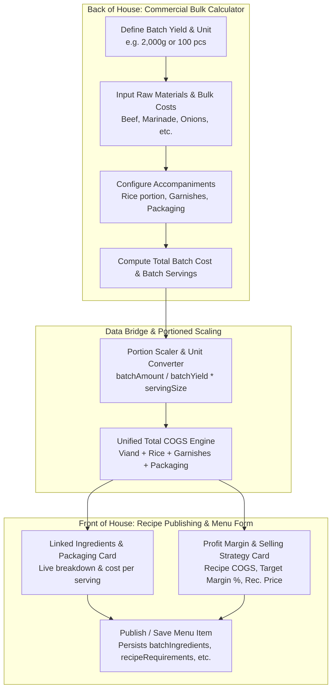

# Commercial Bulk Calculator & Recipe Publishing System Architecture

This guide provides a comprehensive architectural breakdown of how the **Commercial Bulk Calculator** connects to **Publishing New Recipes / Catalog Items** in Curvada's Kitchen (`src/components/AdminPanel.tsx`).

---

## 1. High-Level Flow Diagram

The kitchen management workflow bridges **back-of-house batch batch preparation** (kilograms, bulk packs, whole cuts) with **front-of-house customer catalog items** (plated servings, meal prices, margins):



---

## 2. State Mapping & Data Bridge

The application maintains two primary state contexts that sync seamlessly:

| Context | State Variable | Purpose |
| :--- | :--- | :--- |
| **Bulk Calculator** | `standaloneIngredients` | Raw bulk ingredients (e.g., 2,500g raw pork belly) |
| **Bulk Calculator** | `standaloneBatchWeight` | Total raw batch yield (e.g. `2000` g or `100` pcs) |
| **Bulk Calculator** | `standaloneBatchUnit` | `'g'` or `'pcs'` |
| **Bulk Calculator** | `standaloneServingGrams` | Portion per plated customer meal (e.g. `90` g or `4` pcs) |
| **Bulk Calculator** | `standaloneIncludeRice` | Boolean toggle for automated steamed rice |
| **Bulk Calculator** | `standaloneRicePortionGrams` | Plated rice serving (e.g. `150` g) |
| **Bulk Calculator** | `standaloneSelectedGarnishes` | Array of per-plate garnishes (fried egg, calamansi, etc.) |
| **Bulk Calculator** | `standaloneSelectedPackaging` | Array of takeout containers (microwavable clamshell, etc.) |
| **Bulk Calculator** | `standaloneTargetMargin` | Desired profit margin % (e.g., `50%`) |
| **Menu Form** | `formBatchIngredients` | Replicates batch raw materials in the menu modal |
| **Menu Form** | `formRecipeRequirements` | **Per-serving** ingredient requirements for stock deductions |
| **Menu Form** | `formGarnishes` | Selected garnishes saved to catalog item |
| **Menu Form** | `formPackaging` | Selected packaging saved to catalog item |
| **Menu Form** | `formPrice` | Actual customer menu selling price (₱) |
| **Menu Form** | `formTargetMargin` | Item-specific target profit margin % |

---

## 3. Four Core Sync Touchpoints

### Touchpoint 1: Bulk Calculator $\rightarrow$ Menu Item Modal (`openMenuForm: true`)
- **Trigger**: Clicking **"Publish / Create New Dish in Catalog"** inside the Bulk Calculator.
- **Handler**: `handleSaveAllBatchCostingChanges({ openMenuForm: true })` (lines ~6193–6450).
- **Behavior**:
  1. Computes `batchServings = batchYield / servingSize`.
  2. Scales each bulk ingredient to per-serving plate weight:
     $$\text{Plate Amount} = \frac{\text{rawAmount}}{\text{batchWeight}} \times \text{servingG}$$
  3. Automatically infers menu category (`silog`, `bento`, `rice-bowl`, `drinks`) from recipe name keywords.
  4. Auto-assigns image presets and descriptions.
  5. Opens the **"Publish New Recipe"** modal with all quantities pre-filled.

---

### Touchpoint 2: Menu Item Modal $\rightarrow$ Bulk Calculator (`handleSendRecipeFormToBatchCalc`)
- **Trigger**: Clicking **"🧮 Configure in Bulk Calculator →"** or **"Open Bulk Calculator →"** inside the Add/Edit Menu Item modal.
- **Handler**: `handleSendRecipeFormToBatchCalc()` (lines ~7259–7300).
- **Behavior**:
  1. Copies `formBatchIngredients`, `formBatchYieldGrams`, `formServingSizeGrams`, `formGarnishes`, and `formPackaging` back into the Bulk Calculator.
  2. Opens the Commercial Bulk Calculator modal for deep adjustments (adding bulk spices, changing batch yield kg, tweaking suppliers).

---

### Touchpoint 3: In-Modal Active Bulk Import (`handleApplyTemplateDirectlyToForm`)
- **Trigger**: In the Add/Edit form, clicking **"📥 Load Bulk Calculator Batch"** or choosing `__active_bulk__` from the recipe dropdown.
- **Handler**: `handleApplyTemplateDirectlyToForm('__active_bulk__')` (lines ~6522–6650).
- **Behavior**:
  1. Instantly pulls the active Bulk Calculator state into the open form without reloading.
  2. Populates `formBatchIngredients`, `formRecipeRequirements`, `formPrice`, and `formTargetMargin`.

---

### Touchpoint 4: Unified Direct Save (`handleSubmitMenuItem`)
- **Trigger**: Clicking **"Publish New Recipe"** or **"Publish Updates"** (lines ~8269–8410).
- **Behavior**:
  1. Verifies `effectiveBatch`, `effectiveGarnishes`, and `effectivePackaging`.
  2. If the user configured items in the Bulk Calculator but hasn't explicitly clicked "Apply", the system falls back to `standaloneIngredients`, ensuring **zero data loss**.
  3. Saves the final `MenuItem` object with:
     - `recipeRequirements`: Used by the POS & order engine to automatically deduct inventory stock upon sale.
     - `batchIngredients`: Preserved for commercial batch batching logs.
     - `garnishes` & `packaging`: Attached for per-plate itemized costing.

---

## 4. Mathematical Costing & Pricing Engine

Both the **Linked Items Breakdown Card** and the **Profit Margin & Selling Strategy Card** run on a unified calculation scope:

### 1. Viand Cost per Plate
$$\text{Viand Cost} = \sum \left( \text{portionAmount} \times \text{costPerUnit} \right)$$
*(Handles unit conversions: kg/l $\rightarrow$ g/ml).*

### 2. Rice Cost per Plate
$$\text{Rice Cost} = \text{portionGrams} \times \text{costPerGram}$$

### 3. Garnishes & Packaging
$$\text{Garnish Cost} = \sum \left( \text{quantity} \times \text{effectiveRate} \right)$$
$$\text{Packaging Cost} = \sum \left( \text{quantity} \times \text{unitCost} \right)$$

### 4. Total COGS / Serving
$$\text{Total COGS} = \text{Viand Cost} + \text{Rice Cost} + \text{Garnish Cost} + \text{Packaging Cost}$$

### 5. Recommended Price & Actual Profit
$$\text{Recommended Price} = \frac{\text{Total COGS}}{1 - (\text{Target Margin \%} / 100)}$$
$$\text{Estimated Profit} = \text{Selling Price} - \text{Total COGS}$$
$$\text{Actual Margin \%} = \frac{\text{Selling Price} - \text{Total COGS}}{\text{Selling Price}} \times 100$$

---

## 5. Summary of the COGS Sync Fix

| Aspect | Prior Behavior (Desynced) | New Behavior (Unified) |
| :--- | :--- | :--- |
| **Calculation Scope** | Two isolated IIFEs with separate, drifting logic. | Single combined IIFE wrapping both cards in [AdminPanel.tsx](file:///d:/DEVELOPMENT/curvada's-kitchen/src/components/AdminPanel.tsx). |
| **Garnishes & Packaging in Profit Card** | Ignored inventory lookup; assumed rate was 0. | Uses `getGarnishEffectiveRate` and inventory lookup for packaging. |
| **Standalone Bulk Fallback** | Profit card ignored `standaloneIngredients` when `formBatchIngredients` wasn't committed, causing `modalCogs = 0`. | Both cards evaluate `effectiveBatch` and `totalCogs` identically. |
| **Fallback Formula** | $3 \times 0.35 = ₱1.05$ overrode the real ₱31.01 COGS. | Real ₱31.01 COGS is directly bound to `Recipe COGS`. |
| **Recommended Selling Price** | Suggested ₱2.02 based on ₱1.05 cost. | Accurately computes recommended price (e.g., ₱60 based on ₱31.01 cost at 48% target margin). |

---

## 6. How to Verify & Audit in Code

1. Open `src/components/AdminPanel.tsx`.
2. Locate line **~13881**: `/* Linked Ingredients, Packaging & Profit Margin Calculator */`.
3. Notice that `totalCogs` is computed once:
   ```ts
   const totalCogs = viandCost + riceCost + garnishCost + pkgCost;
   let modalCogs = totalCogs;
   ```
4. Observe that both cards:
   - **Linked Items Card**: Displays `₱{totalCogs.toFixed(2)}`
   - **Profit Margin Card**: Displays `Recipe COGS ₱{modalCogs.toFixed(2)}`
   share the identical variable and update simultaneously in real-time as prices or ingredients change.
